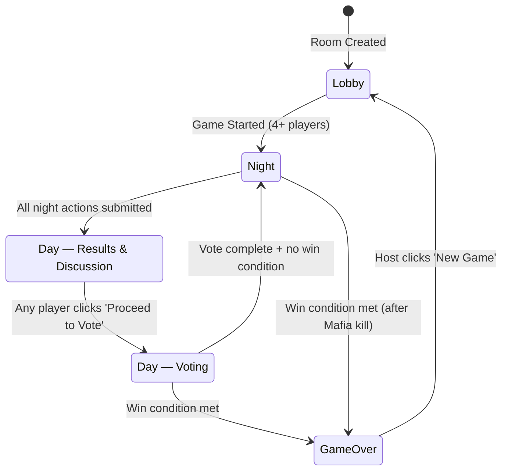

# 🎭 Mafia Online — Design & Implementation Plan

## Overview
A real-time multiplayer Mafia game web app where friends can create/join rooms and play multiple games together, with the server acting as the automated moderator.

---

## Tech Stack

| Layer | Technology |
|-------|-----------|
| Frontend | **Next.js** (React) with TypeScript |
| Backend | **Node.js + Express + Socket.IO** with TypeScript |
| Database | **SQLite** (via `better-sqlite3`) — lightweight persistence |
| Styling | **Tailwind CSS** — dark noir theme, mobile-first |
| Project Structure | **Monorepo** — `/client` and `/server` directories |
| Real-time | **Socket.IO** for WebSocket communication |

---

## Core Rules & Configuration

### Players
- **Min players:** 4
- **Max players:** 15
- **Identity:** No accounts — players enter a display name when joining a room

### Roles
| Total Players | Mafias | Doctor | Police | Citizens |
|:---:|:---:|:---:|:---:|:---:|
| 4–5 | 1 | 1 | 1 | 1–2 |
| 6–8 | 2 | 1 | 1 | 2–4 |
| 9–11 | 3 | 1 | 1 | 4–6 |
| 12–15 | 4 | 1 | 1 | 6–9 |

- Always exactly **1 Doctor** and **1 Police**
- Roles assigned **randomly** at game start

### Win Conditions
- **Town wins:** All Mafias are eliminated
- **Mafia wins:** Number of living Mafias ≥ number of living non-Mafia players

---

## Game Flow



### Phase Details

#### 🌙 Night Phase
All actions happen simultaneously. Phase ends when **all living special roles have acted**:

1. **Mafia** — Private chat among Mafias. A rotating Mafia leader submits the final kill target.
   - Leader rotates each night among living Mafias
   - Mafias can see each other's identities and chat privately
   
2. **Police** — Selects one player to investigate.
   - Receives a private result: "Player X **is** Mafia" or "Player X **is not** Mafia"
   - Result shown only to the Police player
   
3. **Doctor** — Selects one player to protect.
   - ✅ Can protect themselves
   - ✅ Can protect the same person on consecutive nights
   - If the Doctor protects the Mafia's target, that player survives

4. **Citizens** — See a "waiting for night to end" screen

#### ☀️ Day — Results & Discussion Phase
- Announce who was killed (or that the Doctor saved someone — without revealing who the Doctor is)
- Players discuss **externally** (voice call, in-person, etc.)
- Any alive player can click **"Proceed to Vote"** to advance

#### 🗳️ Day — Voting Phase
- Every alive player **must** vote for someone to eliminate (no abstaining)
- Player with the most votes is eliminated
- **Ties = no elimination**
- Eliminated player's role is **NOT revealed** (roles hidden until game over)

### Dead Players
- Become **spectators** with a **"god view"** — can see all roles, all night actions, and all private information
- Cannot chat or vote

---

## Room Mechanics

### Creating a Room
- Any visitor can create a room from the homepage
- Room gets a **short random code** (e.g., `ABCD12`) — 6 characters, alphanumeric
- Creator enters their display name and is placed in the lobby

### Joining a Room  
- Enter room code + display name on the homepage
- Duplicate names within a room are not allowed

### Starting a Game
- **Any player** in the room can start the game (not host-restricted)
- Requires minimum 4 players

### Subsequent Games
- After a game ends, any player can click **"New Game"**
- Roles are re-shuffled; same players continue
- New players can join between games (from lobby state)

### Disconnection Handling
- Player marked as **disconnected** — given **60 seconds** to reconnect
- If they don't reconnect: **auto-eliminated** from the current game
- Between games: disconnected players are **removed from the room**
- Reconnection uses a session token stored in the browser

---

## Project Structure

```
mafia/
├── client/                     # Next.js frontend
│   ├── src/
│   │   ├── app/                # Next.js App Router pages
│   │   │   ├── page.tsx        # Homepage — Create/Join room
│   │   │   └── room/
│   │   │       └── [code]/
│   │   │           └── page.tsx # Game room page
│   │   ├── components/         # React components
│   │   │   ├── Lobby.tsx       # Pre-game lobby
│   │   │   ├── NightPhase.tsx  # Night phase UI (role-specific)
│   │   │   ├── DayReveal.tsx   # Day results & discussion
│   │   │   ├── DayVoting.tsx   # Voting UI
│   │   │   ├── GameOver.tsx    # End game screen + role reveal
│   │   │   ├── PlayerList.tsx  # Player list sidebar
│   │   │   ├── MafiaChat.tsx   # Private Mafia chat (night)
│   │   │   └── SpectatorView.tsx # Dead player god view
│   │   ├── hooks/              # Custom React hooks
│   │   │   └── useSocket.ts    # Socket.IO connection hook
│   │   ├── lib/                # Utilities
│   │   │   └── types.ts        # Shared TypeScript types
│   │   └── styles/             # Global styles
│   ├── tailwind.config.ts
│   ├── next.config.ts
│   ├── package.json
│   └── tsconfig.json
│
├── server/                     # Express + Socket.IO backend
│   ├── src/
│   │   ├── index.ts            # Server entry point
│   │   ├── socket/             # Socket.IO event handlers
│   │   │   ├── roomHandlers.ts # Room create/join/leave
│   │   │   └── gameHandlers.ts # Game action handlers
│   │   ├── game/               # Game logic
│   │   │   ├── GameManager.ts  # Orchestrates game state
│   │   │   ├── RoleAssigner.ts # Random role assignment
│   │   │   ├── NightPhase.ts   # Night phase logic
│   │   │   ├── DayPhase.ts     # Day phase logic
│   │   │   └── WinChecker.ts   # Win condition evaluation
│   │   ├── models/             # Data models
│   │   │   ├── Room.ts         # Room state
│   │   │   ├── Player.ts       # Player state
│   │   │   └── Game.ts         # Game state
│   │   ├── db/                 # SQLite database
│   │   │   ├── database.ts     # DB connection & setup
│   │   │   └── migrations.ts   # Schema migrations
│   │   └── utils/              # Utilities
│   │       └── codeGenerator.ts # Room code generation
│   ├── package.json
│   └── tsconfig.json
│
├── shared/                     # Shared types between client & server
│   └── types.ts
│
├── package.json                # Root package.json (workspaces)
└── README.md
```

---

## UI / UX Design

### Theme
- **Dark noir aesthetic** — deep grays, blacks, with red and gold accents
- Mobile-first responsive design
- Clean, modern typography

### Key Screens

1. **Homepage** — Create room (enter name) or Join room (enter code + name)
2. **Lobby** — Player list, room code display, "Start Game" button
3. **Night Phase** — Role-specific action UI:
   - Mafia: Private chat + target selection (leader confirms)
   - Police: Player selection for investigation
   - Doctor: Player selection for protection
   - Citizen: Waiting screen with atmospheric animation
4. **Day — Results** — Night outcome announcement + "Proceed to Vote" button
5. **Day — Voting** — Vote for a player to eliminate
6. **Game Over** — Winner announcement + full role reveal for all players
7. **Spectator View** — God view showing all roles, actions, and game state

---

## Socket.IO Events

### Client → Server
| Event | Payload | Description |
|-------|---------|-------------|
| `create-room` | `{ playerName }` | Create a new room |
| `join-room` | `{ roomCode, playerName }` | Join existing room |
| `start-game` | `{ roomCode }` | Start the game |
| `mafia-chat` | `{ roomCode, message }` | Mafia private message |
| `mafia-kill` | `{ roomCode, targetId }` | Mafia leader submits kill |
| `police-investigate` | `{ roomCode, targetId }` | Police investigates player |
| `doctor-protect` | `{ roomCode, targetId }` | Doctor protects player |
| `proceed-to-vote` | `{ roomCode }` | Advance to voting phase |
| `cast-vote` | `{ roomCode, targetId }` | Vote to eliminate player |
| `new-game` | `{ roomCode }` | Start a new game in same room |

### Server → Client
| Event | Payload | Description |
|-------|---------|-------------|
| `room-created` | `{ roomCode, playerId }` | Room created successfully |
| `room-joined` | `{ players, roomState }` | Joined room successfully |
| `player-joined` | `{ player }` | New player joined |
| `game-started` | `{ role, players }` | Game begun, role assigned |
| `night-started` | `{ round, mafiaLeader? }` | Night phase begins |
| `mafia-message` | `{ from, message }` | Mafia chat message |
| `investigation-result` | `{ targetName, isMafia }` | Police result (to Police only) |
| `day-results` | `{ killed, saved }` | Night results |
| `vote-update` | `{ votes }` | Current vote tally |
| `player-eliminated` | `{ playerId }` | Player eliminated by vote |
| `game-over` | `{ winner, roles }` | Game ended, all roles revealed |
| `player-disconnected` | `{ playerId }` | Player connection lost |
| `player-reconnected` | `{ playerId }` | Player reconnected |
| `spectator-update` | `{ fullGameState }` | God view update for dead players |

---

## Database Schema (SQLite)

```sql
-- Rooms persist across server restarts
CREATE TABLE rooms (
    code TEXT PRIMARY KEY,
    created_at DATETIME DEFAULT CURRENT_TIMESTAMP,
    status TEXT DEFAULT 'lobby' -- lobby, in_game, game_over
);

CREATE TABLE players (
    id TEXT PRIMARY KEY,
    room_code TEXT REFERENCES rooms(code),
    name TEXT NOT NULL,
    session_token TEXT UNIQUE NOT NULL,
    connected BOOLEAN DEFAULT TRUE,
    disconnected_at DATETIME,
    created_at DATETIME DEFAULT CURRENT_TIMESTAMP
);

CREATE TABLE games (
    id INTEGER PRIMARY KEY AUTOINCREMENT,
    room_code TEXT REFERENCES rooms(code),
    status TEXT DEFAULT 'night', -- night, day_reveal, day_voting, finished
    current_round INTEGER DEFAULT 1,
    winner TEXT, -- 'town', 'mafia', NULL
    created_at DATETIME DEFAULT CURRENT_TIMESTAMP
);

CREATE TABLE game_players (
    game_id INTEGER REFERENCES games(id),
    player_id TEXT REFERENCES players(id),
    role TEXT NOT NULL, -- 'mafia', 'doctor', 'police', 'citizen'
    is_alive BOOLEAN DEFAULT TRUE,
    PRIMARY KEY (game_id, player_id)
);

CREATE TABLE night_actions (
    id INTEGER PRIMARY KEY AUTOINCREMENT,
    game_id INTEGER REFERENCES games(id),
    round INTEGER NOT NULL,
    action_type TEXT NOT NULL, -- 'kill', 'investigate', 'protect'
    actor_id TEXT REFERENCES players(id),
    target_id TEXT REFERENCES players(id)
);

CREATE TABLE day_votes (
    game_id INTEGER REFERENCES games(id),
    round INTEGER NOT NULL,
    voter_id TEXT REFERENCES players(id),
    target_id TEXT REFERENCES players(id),
    PRIMARY KEY (game_id, round, voter_id)
);
```

---

## Implementation Order

> [!IMPORTANT]
> Build in this order to ensure each phase is testable:

### Phase 1: Foundation
1. Initialize monorepo with workspaces (`client/`, `server/`, `shared/`)
2. Set up Express + Socket.IO server with TypeScript
3. Set up Next.js client with Tailwind CSS (dark theme)
4. Set up SQLite database with schema
5. Implement shared types

### Phase 2: Room System
6. Room creation (code generation, DB storage)
7. Room joining (code validation, name uniqueness)
8. Lobby UI (player list, room code display)
9. Socket.IO connection management + reconnection

### Phase 3: Core Game Loop
10. Role assignment logic
11. Night phase — Mafia kill selection (with rotating leader)
12. Night phase — Mafia private chat
13. Night phase — Police investigation
14. Night phase — Doctor protection
15. Night → Day transition (resolve kills, saves)
16. Day reveal phase UI
17. Day voting phase
18. Win condition checking
19. Game over screen with full role reveal

### Phase 4: Polish
20. Spectator/god view for dead players
21. Disconnection handling (60s timeout, auto-eliminate)
22. Subsequent games ("New Game" flow)
23. Mobile-responsive polish
24. Error handling & edge cases

---

> [!NOTE]
> **Not included in v1** (potential future features): game history/stats, password-protected rooms, custom role configurations, additional roles (e.g., Serial Killer, Jester), in-app text chat for day discussion, sound effects/notifications.
